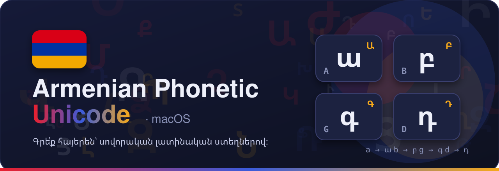
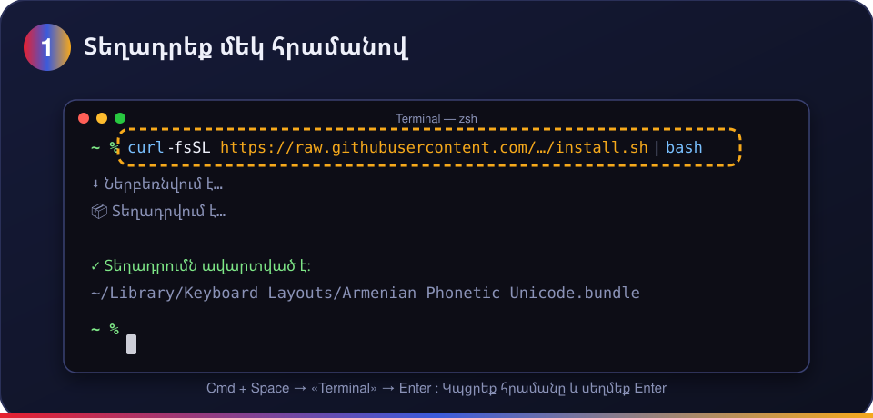
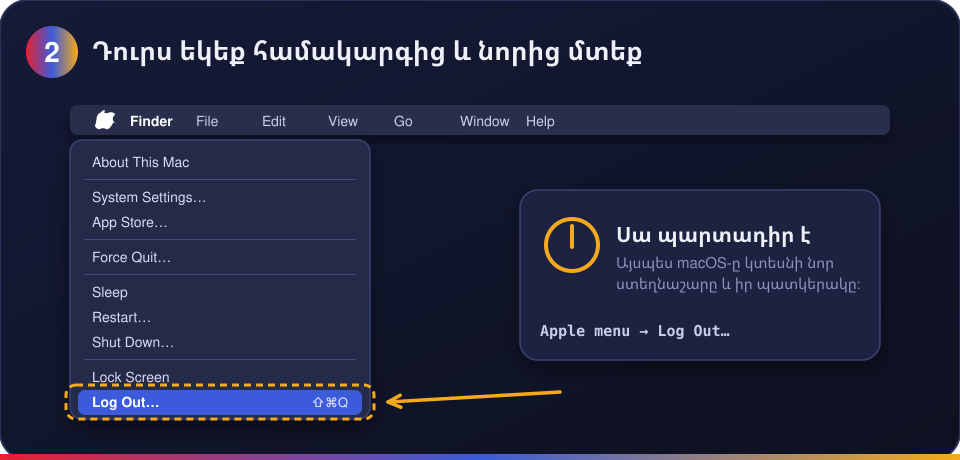
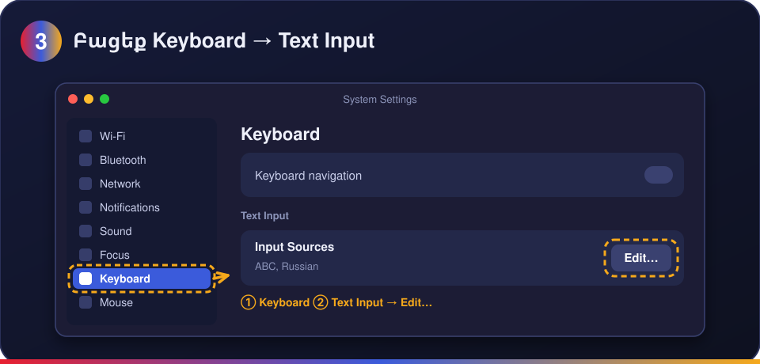
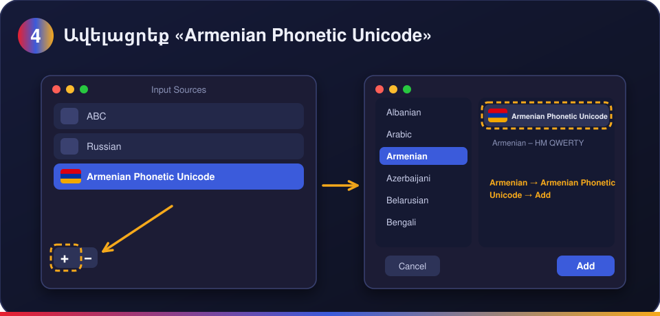
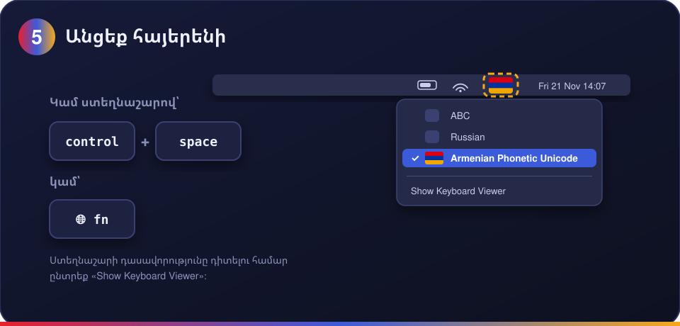
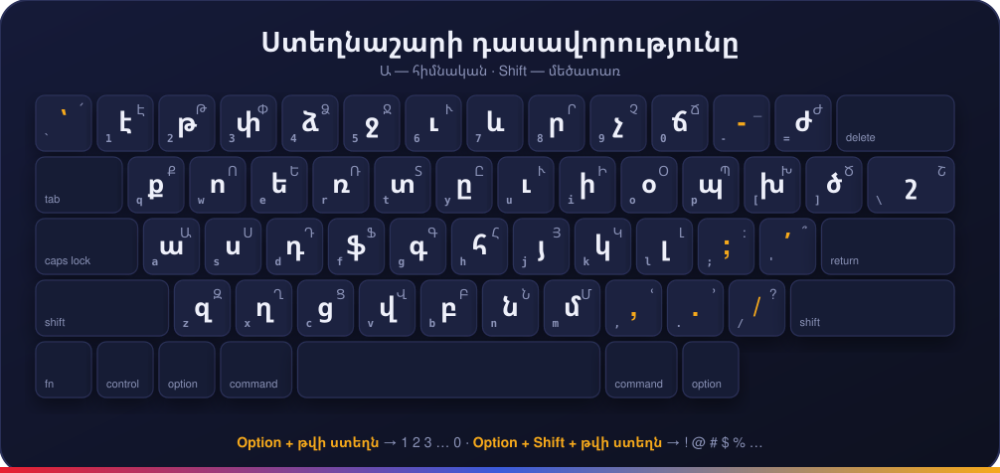

<p align="center">
  
</p>

<h3 align="center">Հայերեն ֆոնետիկ ստեղնաշար macOS-ի համար</h3>

<p align="center">
  Գրե՛ք հայերեն՝ ձեր սովորական լատինական ստեղներով։<br>
  Ոչ մի ավելորդ ծրագիր՝ միայն ստեղնաշարի դասավորություն։
</p>

<p align="center">
  
  
  
  
</p>

---

## ✨ Առանձնահատկություններ

| | |
|---|---|
| 🔤 **Ֆոնետիկ դասավորություն** | `a → ա`, `b → բ`, `g → գ`, `d → դ` … ստեղները համապատասխանում են հնչյուններին, ուստի նոր դասավորություն սովորել պետք չէ։ |
| 🌐 **Յունիկոդ** | Աշխատում է ամենուր՝ բրաուզերներում, փաստաթղթերում, մեսենջերներում, տերմինալում։ |
| ⚡ **Տեղադրում մեկ տողով** | Մեկ հրաման Տերմինալում՝ առանց Gatekeeper-ի զգուշացումների և առանց ֆայլեր քարշ տալու։ |
| 🪶 **Թեթև և անվտանգ** | Ոչ մի ֆոնային ծրագիր, ոչ մի թույլտվություն, ոչ մի `sudo`։ Ֆայլը պատճենվում է միայն ձեր օգտատիրոջ թղթապանակ։ |
| 🔢 **Թվեր** | Թվերի շարքում հայերեն տառեր են, իսկ թվերը գրվում են `Option` + թվի ստեղն։ |
| ✍️ **Կետադրական նշաններ** | Հայերեն շեշտը, հարցականը և բացականչությունը՝ `՛` `՞` `՜` `՝` ։ |

---

## 🚀 Տեղադրում

Բացեք **Տերմինալը** (`⌘ Space` → `Terminal` → `Enter`), կպցրեք հետևյալ հրամանը և սեղմեք `Enter`.

```bash
curl -fsSL https://raw.githubusercontent.com/Fahrad20/Armenian-Phonetic-Unicode-macOS/main/install.sh | bash
```

> 💡 **Ինչու՞ Տերմինալով։** macOS-ը արգելափակում է ինտերնետից ներբեռնված չստորագրված ֆայլերը («Apple could not verify…»)։
> `curl`-ով ստացված ֆայլերը չեն արգելափակվում, ուստի ոչ մի զգուշացում չի լինի։

Ստորև ամբողջ ընթացքը՝ քայլ առ քայլ։

### 1️⃣ Գործարկեք հրամանը

<p align="center"></p>

Երբ տեսնեք **✓ Տեղադրումն ավարտված է**, Տերմինալը կարող եք փակել։

### 2️⃣ Դուրս եկեք համակարգից և նորից մտեք

<p align="center"></p>

Սա պարտադիր է. միայն այդպես macOS-ը կտեսնի նոր ստեղնաշարը և նրա պատկերակը։
Ընտրեք **Apple ցանկ → Log Out…** (`⇧ ⌘ Q`)։

### 3️⃣ Բացեք ստեղնաշարի կարգավորումները

<p align="center"></p>

**System Settings → Keyboard → Text Input → Edit…**

### 4️⃣ Ավելացրեք դասավորությունը

<p align="center"></p>

Սեղմեք **«+»**, ձախ սյունակում ընտրեք **Armenian**, ապա՝ **Armenian Phonetic Unicode** և սեղմեք **Add**։

> Եթե դասավորությունը չեք գտնում **Armenian**-ի տակ, փնտրեք **Others** բաժնում։

### 5️⃣ Անցեք հայերենի

<p align="center"></p>

Լեզուն փոխեք էկրանի վերին աջ մասում գտնվող պատկերակին սեղմելով, կամ ստեղնաշարով՝ `⌃ Control` + `Space`, կամ `🌐 fn`։

🎉 **Պատրաստ է։ Գրե՛ք հայերեն։**

---

## ⌨️ Դասավորությունը

<p align="center"></p>

Մեծ նշանը հիմնականն է, վերին աջ անկյունում՝ `Shift`-ի հետ ստացվողը, ներքևի ձախ անկյունում՝ ստեղնի լատինական անունը։

**Օրինակներ**

| Սեղմեք | Արդյունք |
|---|---|
| `Shift` + `h`, `a`, `j`, `a`, `s`, `t`, `a`, `n` | **Հայաստան** |
| `b`, `a`, `8`, `7` | **բարև** |

**Ի՞նչ է կարևոր իմանալ**

- `ր` տառը **8** ստեղնի վրա է, իսկ `ռ`-ը՝ **R**-ի։
- `և` տառը **7** ստեղնի վրա է։
- Թվեր գրելու համար սեղմեք `Option` + թվի ստեղն (`Option` + `Shift` + թվի ստեղն՝ `!` `@` `#` `$` … ), իսկ աջ կողմի թվային ստեղնաշարը աշխատում է սովորական ձևով։

---

## 🔄 Թարմացում

Նորից գործարկեք տեղադրման հրամանը, ապա դուրս եկեք համակարգից և նորից մտեք։

## 🗑️ Հեռացում

```bash
curl -fsSL https://raw.githubusercontent.com/Fahrad20/Armenian-Phonetic-Unicode-macOS/main/uninstall.sh | bash
```

Ապա դուրս եկեք համակարգից և նորից մտեք։

---

## ❓ Հաճախ տրվող հարցեր

<details>
<summary><b>Ստեղնաշարը չի երևում ցանկում</b></summary>

1. Համոզվեք, որ դուրս եք եկել համակարգից և նորից մտել (կամ վերագործարկել եք Mac-ը)։
2. Բացեք Finder, սեղմեք `⇧ ⌘ G`, մուտքագրեք `~/Library/Keyboard Layouts` և ստուգեք, որ այնտեղ կա `Armenian Phonetic Unicode.bundle`։
3. Ավելացնելիս փնտրեք **Armenian**-ի տակ, իսկ եթե չկա՝ **Others**-ում։
</details>

<details>
<summary><b>Չեմ ուզում օգտագործել Տերմինալը</b></summary>

1. Այս էջում սեղմեք **Code → Download ZIP** և բացեք արխիվը։
2. Finder-ում սեղմեք `⇧ ⌘ G` և մուտքագրեք `~/Library/Keyboard Layouts`։
3. Թղթապանակի մեջ քարշ տվեք `Keyboard Layout/Armenian Phonetic Unicode.bundle`-ը։
4. Դուրս եկեք համակարգից, նորից մտեք և ավելացրեք դասավորությունը (քայլեր 3–5)։
</details>

<details>
<summary><b>Անվտանգ է՞ տեղադրման հրամանը</b></summary>

Այո, և դա կարող եք ստուգել ինքներդ։ [`install.sh`](install.sh) սկրիպտը կարճ է ու բաց.

1. ներբեռնում է այս պահոցը GitHub-ից ժամանակավոր թղթապանակ,
2. պատճենում է `Armenian Phonetic Unicode.bundle`-ը `~/Library/Keyboard Layouts` թղթապանակ,
3. ջնջում է ժամանակավոր ֆայլերը և բացում կարգավորումները։

`sudo` չի օգտագործվում, համակարգային ֆայլերին ոչինչ չի դիպչում։
</details>

<details>
<summary><b>Թվերը չեն գրվում</b></summary>

Վերևի շարքի ստեղներին հայերեն տառեր են։ Թվերի համար սեղմեք `Option` + թվի ստեղն։
</details>

---

## 📁 Պահոցի կառուցվածքը

```text
Armenian-Phonetic-Unicode-macOS/
├── install.sh                  ← տեղադրում մեկ տողով
├── uninstall.sh                ← հեռացում մեկ տողով
├── Install.command             ← տեղային տեղադրում (եթե արդեն ներբեռնել եք պահոցը)
├── Uninstall.command
├── Keyboard Layout/
│   └── Armenian Phonetic Unicode.bundle
└── assets/                     ← նկարազարդումներ
```

---

<p align="center">
  Պատրաստված է ❤️-ով՝ հայերեն գրողների համար։
</p>
